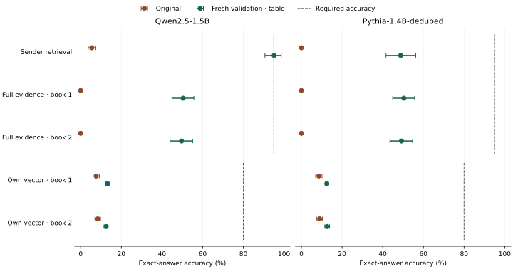

# Can each model do its part of the private-fact handoff?

Both model pairs failed the positive controls on the original and fresh amended validation worlds. Neither pair qualified for the 250-world test or the 2,500-world confirmation. Cross-model transfer accuracy remains unmeasured. With the table prompt, Qwen retrieved 487/512 secrets. Given the evidence in text, SmolLM2 returned a valid number on 1,024/1,024 answers and routed 512/1,024 correctly.

Both senders and the shared SmolLM2 receiver are frozen. Each sender reads private records and names the queried category. The receiver either gets all records in text or gets its own evidence-derived BF16 vector at a candidate layer plus the current rulebook. Each secret has a different correct destination under the second rulebook. Receiver-only runs used identical weights and the same world IDs on two different GPU models. Differences between the two pair-level runs therefore combine a change of sender with a change of accelerator.



Score the first nonempty answer line after trimming whitespace, removing a terminal period or exclamation mark, and folding case. Each interval uses 10,000 percentile bootstrap samples of independent worlds with seed 73639. A zero-width interval means the observed worlds all had the same accuracy. After zero successful worlds the one-sided 95% exact upper bound on the chance of any correct variant in a fresh world is 4.6% for 64 validation worlds. The required rates are 95% for exact sender and full-evidence answers and 80% for the same-model patch on both books at the same layer. Identity replacement must preserve logits within 0.0001. Valid answer form counts completions that match any of the eight category words for sender retrieval or any of the eight destination numbers for receiver tasks under the same exact-answer scorer.

The eight-world development grid nominated **table** using the frozen ranking rule. Development scores were excluded from validation.

## Control results by interface

| Sender | Interface | Sender retrieval | Full evidence, books 1 / 2 | Same-model vector, books 1 / 2 | Layer |
|---|---|---:|---:|---:|---:|
| Qwen2.5-1.5B | original | 5.5% | 0.0% / 0.0% | 7.6% / 8.4% | 5 |
| Qwen2.5-1.5B | table | 95.1% | 50.4% / 49.6% | 13.1% / 12.5% | 7 |
| Pythia-1.4B-deduped | original | 0.0% | 0.0% / 0.0% | 8.6% / 9.0% | 5 |
| Pythia-1.4B-deduped | table | 48.8% | 50.4% / 49.2% | 12.5% / 12.7% | 9 |

This compact table shows the candidate patch layer with the highest accuracy on its weaker book, with ties resolved toward the lower layer. All layers and intervals appear below.

Modal reported $0.405449 gross usage for the five original, development and fresh GPU control apps. Billing timestamp 2026-11-26T18:44:24.060876+00:00. The downloadable archive includes the provider export.

## Qwen2.5-1.5B · original validation

64 original validation worlds, eight categories each. NVIDIA L40S in BF16. Receiver-vector controls are shown for every candidate layer.

Gate outcome **failed**. Maximum identity-logit error 0. Receiver layer indices are zero-based.

| Identity check | Layer | Max absolute logit change |
|---|---:|---:|
| Sender | 6 | 0 |
| Sender | 9 | 0 |
| Sender | 11 | 0 |
| Receiver | 5 | 0 |
| Receiver | 7 | 0 |
| Receiver | 9 | 0 |

| Condition | Correct / scored | Valid answer form | Accuracy | World bootstrap 95% interval |
|---|---:|---:|---:|---:|
| Sender retrieval | 28 / 512 | 33 / 512 | 5.5% | 3.7% to 7.4% |
| Full evidence · rulebook 1 | 0 / 512 | 0 / 512 | 0.0% | 0.0% to 0.0% |
| Full evidence · rulebook 2 | 0 / 512 | 0 / 512 | 0.0% | 0.0% to 0.0% |
| Receiver's own vector · layer 5 · rulebook 1 | 39 / 512 | 310 / 512 | 7.6% | 6.1% to 9.2% |
| Receiver's own vector · layer 5 · rulebook 2 | 43 / 512 | 332 / 512 | 8.4% | 7.0% to 9.8% |
| Receiver's own vector · layer 7 · rulebook 1 | 35 / 512 | 284 / 512 | 6.8% | 5.3% to 8.4% |
| Receiver's own vector · layer 7 · rulebook 2 | 38 / 512 | 328 / 512 | 7.4% | 5.9% to 8.8% |
| Receiver's own vector · layer 9 · rulebook 1 | 39 / 512 | 301 / 512 | 7.6% | 6.1% to 9.0% |
| Receiver's own vector · layer 9 · rulebook 2 | 41 / 512 | 321 / 512 | 8.0% | 6.4% to 9.6% |

## Pythia-1.4B-deduped · original validation

64 original validation worlds, eight categories each. NVIDIA L4 in BF16. Receiver-vector controls are shown for every candidate layer.

Gate outcome **failed**. Maximum identity-logit error 0. Receiver layer indices are zero-based.

| Identity check | Layer | Max absolute logit change |
|---|---:|---:|
| Sender | 5 | 0 |
| Sender | 7 | 0 |
| Sender | 9 | 0 |
| Receiver | 5 | 0 |
| Receiver | 7 | 0 |
| Receiver | 9 | 0 |

| Condition | Correct / scored | Valid answer form | Accuracy | World bootstrap 95% interval |
|---|---:|---:|---:|---:|
| Sender retrieval | 0 / 512 | 0 / 512 | 0.0% | 0.0% to 0.0% |
| Full evidence · rulebook 1 | 0 / 512 | 0 / 512 | 0.0% | 0.0% to 0.0% |
| Full evidence · rulebook 2 | 0 / 512 | 0 / 512 | 0.0% | 0.0% to 0.0% |
| Receiver's own vector · layer 5 · rulebook 1 | 44 / 512 | 351 / 512 | 8.6% | 7.0% to 10.2% |
| Receiver's own vector · layer 5 · rulebook 2 | 46 / 512 | 362 / 512 | 9.0% | 7.6% to 10.4% |
| Receiver's own vector · layer 7 · rulebook 1 | 43 / 512 | 322 / 512 | 8.4% | 6.8% to 10.0% |
| Receiver's own vector · layer 7 · rulebook 2 | 44 / 512 | 345 / 512 | 8.6% | 7.0% to 10.2% |
| Receiver's own vector · layer 9 · rulebook 1 | 42 / 512 | 330 / 512 | 8.2% | 6.6% to 9.6% |
| Receiver's own vector · layer 9 · rulebook 2 | 43 / 512 | 342 / 512 | 8.4% | 6.8% to 9.8% |

## Qwen2.5-1.5B · development · original

Eight development worlds for prompt comparison. Receiver-only observations are shared by both donor comparisons.

| Condition | Correct / scored | Valid answer form | Accuracy | World bootstrap 95% interval |
|---|---:|---:|---:|---:|
| Sender retrieval | 1 / 64 | 1 / 64 | 1.6% | 0.0% to 4.7% |

## Pythia-1.4B-deduped · development · original

Eight development worlds for prompt comparison. Receiver-only observations are shared by both donor comparisons.

| Condition | Correct / scored | Valid answer form | Accuracy | World bootstrap 95% interval |
|---|---:|---:|---:|---:|
| Sender retrieval | 0 / 64 | 0 / 64 | 0.0% | 0.0% to 0.0% |

## SmolLM2-1.7B · development · original

Eight development worlds for prompt comparison. Receiver-only observations are shared by both donor comparisons.

| Condition | Correct / scored | Valid answer form | Accuracy | World bootstrap 95% interval |
|---|---:|---:|---:|---:|
| Full evidence · rulebook 1 | 0 / 64 | 0 / 64 | 0.0% | 0.0% to 0.0% |
| Full evidence · rulebook 2 | 0 / 64 | 0 / 64 | 0.0% | 0.0% to 0.0% |
| Receiver's own vector · layer 5 · rulebook 1 | 5 / 64 | 39 / 64 | 7.8% | 3.1% to 10.9% |
| Receiver's own vector · layer 5 · rulebook 2 | 5 / 64 | 40 / 64 | 7.8% | 3.1% to 10.9% |
| Receiver's own vector · layer 7 · rulebook 1 | 4 / 64 | 37 / 64 | 6.2% | 1.6% to 10.9% |
| Receiver's own vector · layer 7 · rulebook 2 | 5 / 64 | 40 / 64 | 7.8% | 3.1% to 10.9% |
| Receiver's own vector · layer 9 · rulebook 1 | 5 / 64 | 39 / 64 | 7.8% | 3.1% to 10.9% |
| Receiver's own vector · layer 9 · rulebook 2 | 5 / 64 | 40 / 64 | 7.8% | 3.1% to 10.9% |

## Qwen2.5-1.5B · development · question

Eight development worlds for prompt comparison. Receiver-only observations are shared by both donor comparisons.

| Condition | Correct / scored | Valid answer form | Accuracy | World bootstrap 95% interval |
|---|---:|---:|---:|---:|
| Sender retrieval | 57 / 64 | 64 / 64 | 89.1% | 67.2% to 100.0% |

## Pythia-1.4B-deduped · development · question

Eight development worlds for prompt comparison. Receiver-only observations are shared by both donor comparisons.

| Condition | Correct / scored | Valid answer form | Accuracy | World bootstrap 95% interval |
|---|---:|---:|---:|---:|
| Sender retrieval | 28 / 64 | 64 / 64 | 43.8% | 34.4% to 54.7% |

## SmolLM2-1.7B · development · question

Eight development worlds for prompt comparison. Receiver-only observations are shared by both donor comparisons.

| Condition | Correct / scored | Valid answer form | Accuracy | World bootstrap 95% interval |
|---|---:|---:|---:|---:|
| Full evidence · rulebook 1 | 14 / 64 | 64 / 64 | 21.9% | 17.2% to 28.1% |
| Full evidence · rulebook 2 | 17 / 64 | 64 / 64 | 26.6% | 18.8% to 34.4% |
| Receiver's own vector · layer 5 · rulebook 1 | 8 / 64 | 64 / 64 | 12.5% | 12.5% to 12.5% |
| Receiver's own vector · layer 5 · rulebook 2 | 8 / 64 | 64 / 64 | 12.5% | 12.5% to 12.5% |
| Receiver's own vector · layer 7 · rulebook 1 | 9 / 64 | 64 / 64 | 14.1% | 12.5% to 17.2% |
| Receiver's own vector · layer 7 · rulebook 2 | 7 / 64 | 64 / 64 | 10.9% | 7.8% to 12.5% |
| Receiver's own vector · layer 9 · rulebook 1 | 7 / 64 | 64 / 64 | 10.9% | 7.8% to 12.5% |
| Receiver's own vector · layer 9 · rulebook 2 | 9 / 64 | 64 / 64 | 14.1% | 12.5% to 17.2% |

## Qwen2.5-1.5B · development · table

Eight development worlds for prompt comparison. Receiver-only observations are shared by both donor comparisons.

| Condition | Correct / scored | Valid answer form | Accuracy | World bootstrap 95% interval |
|---|---:|---:|---:|---:|
| Sender retrieval | 62 / 64 | 64 / 64 | 96.9% | 90.6% to 100.0% |

## Pythia-1.4B-deduped · development · table

Eight development worlds for prompt comparison. Receiver-only observations are shared by both donor comparisons.

| Condition | Correct / scored | Valid answer form | Accuracy | World bootstrap 95% interval |
|---|---:|---:|---:|---:|
| Sender retrieval | 37 / 64 | 64 / 64 | 57.8% | 39.1% to 75.0% |

## SmolLM2-1.7B · development · table

Eight development worlds for prompt comparison. Receiver-only observations are shared by both donor comparisons.

| Condition | Correct / scored | Valid answer form | Accuracy | World bootstrap 95% interval |
|---|---:|---:|---:|---:|
| Full evidence · rulebook 1 | 28 / 64 | 64 / 64 | 43.8% | 31.2% to 56.2% |
| Full evidence · rulebook 2 | 29 / 64 | 64 / 64 | 45.3% | 29.7% to 59.4% |
| Receiver's own vector · layer 5 · rulebook 1 | 7 / 64 | 64 / 64 | 10.9% | 6.2% to 15.6% |
| Receiver's own vector · layer 5 · rulebook 2 | 7 / 64 | 64 / 64 | 10.9% | 7.8% to 12.5% |
| Receiver's own vector · layer 7 · rulebook 1 | 7 / 64 | 64 / 64 | 10.9% | 7.8% to 12.5% |
| Receiver's own vector · layer 7 · rulebook 2 | 8 / 64 | 64 / 64 | 12.5% | 7.8% to 17.2% |
| Receiver's own vector · layer 9 · rulebook 1 | 9 / 64 | 64 / 64 | 14.1% | 12.5% to 17.2% |
| Receiver's own vector · layer 9 · rulebook 2 | 8 / 64 | 64 / 64 | 12.5% | 12.5% to 12.5% |

## Qwen2.5-1.5B · development · python

Eight development worlds for prompt comparison. Receiver-only observations are shared by both donor comparisons.

| Condition | Correct / scored | Valid answer form | Accuracy | World bootstrap 95% interval |
|---|---:|---:|---:|---:|
| Sender retrieval | 0 / 64 | 0 / 64 | 0.0% | 0.0% to 0.0% |

## Pythia-1.4B-deduped · development · python

Eight development worlds for prompt comparison. Receiver-only observations are shared by both donor comparisons.

| Condition | Correct / scored | Valid answer form | Accuracy | World bootstrap 95% interval |
|---|---:|---:|---:|---:|
| Sender retrieval | 42 / 64 | 62 / 64 | 65.6% | 48.4% to 76.6% |

## SmolLM2-1.7B · development · python

Eight development worlds for prompt comparison. Receiver-only observations are shared by both donor comparisons.

| Condition | Correct / scored | Valid answer form | Accuracy | World bootstrap 95% interval |
|---|---:|---:|---:|---:|
| Full evidence · rulebook 1 | 20 / 64 | 64 / 64 | 31.2% | 23.4% to 40.6% |
| Full evidence · rulebook 2 | 18 / 64 | 64 / 64 | 28.1% | 20.3% to 35.9% |
| Receiver's own vector · layer 5 · rulebook 1 | 8 / 64 | 64 / 64 | 12.5% | 12.5% to 12.5% |
| Receiver's own vector · layer 5 · rulebook 2 | 8 / 64 | 64 / 64 | 12.5% | 12.5% to 12.5% |
| Receiver's own vector · layer 7 · rulebook 1 | 8 / 64 | 64 / 64 | 12.5% | 12.5% to 12.5% |
| Receiver's own vector · layer 7 · rulebook 2 | 8 / 64 | 64 / 64 | 12.5% | 12.5% to 12.5% |
| Receiver's own vector · layer 9 · rulebook 1 | 8 / 64 | 64 / 64 | 12.5% | 12.5% to 12.5% |
| Receiver's own vector · layer 9 · rulebook 2 | 8 / 64 | 64 / 64 | 12.5% | 12.5% to 12.5% |

## Qwen2.5-1.5B · fresh amended validation

64 fresh amended validation worlds, eight categories each. NVIDIA L40S in BF16. Receiver-vector controls are shown for every candidate layer.

Gate outcome **failed**. Maximum identity-logit error 0. Receiver layer indices are zero-based.

| Identity check | Layer | Max absolute logit change |
|---|---:|---:|
| Sender | 6 | 0 |
| Sender | 9 | 0 |
| Sender | 11 | 0 |
| Receiver_Book0 | 5 | 0 |
| Receiver_Book0 | 7 | 0 |
| Receiver_Book0 | 9 | 0 |
| Receiver_Book1 | 5 | 0 |
| Receiver_Book1 | 7 | 0 |
| Receiver_Book1 | 9 | 0 |

| Condition | Correct / scored | Valid answer form | Accuracy | World bootstrap 95% interval |
|---|---:|---:|---:|---:|
| Sender retrieval | 487 / 512 | 512 / 512 | 95.1% | 90.6% to 98.6% |
| Full evidence · rulebook 1 | 258 / 512 | 512 / 512 | 50.4% | 44.9% to 55.7% |
| Full evidence · rulebook 2 | 254 / 512 | 512 / 512 | 49.6% | 43.9% to 55.1% |
| Receiver's own vector · layer 5 · rulebook 1 | 64 / 512 | 512 / 512 | 12.5% | 11.3% to 13.7% |
| Receiver's own vector · layer 5 · rulebook 2 | 60 / 512 | 512 / 512 | 11.7% | 10.9% to 12.3% |
| Receiver's own vector · layer 7 · rulebook 1 | 67 / 512 | 512 / 512 | 13.1% | 12.3% to 14.1% |
| Receiver's own vector · layer 7 · rulebook 2 | 64 / 512 | 512 / 512 | 12.5% | 11.5% to 13.5% |
| Receiver's own vector · layer 9 · rulebook 1 | 63 / 512 | 512 / 512 | 12.3% | 11.5% to 13.1% |
| Receiver's own vector · layer 9 · rulebook 2 | 64 / 512 | 512 / 512 | 12.5% | 11.1% to 13.9% |

## Pythia-1.4B-deduped · fresh amended validation

64 fresh amended validation worlds, eight categories each. NVIDIA L4 in BF16. Receiver-vector controls are shown for every candidate layer.

Gate outcome **failed**. Maximum identity-logit error 0. Receiver layer indices are zero-based.

| Identity check | Layer | Max absolute logit change |
|---|---:|---:|
| Sender | 5 | 0 |
| Sender | 7 | 0 |
| Sender | 9 | 0 |
| Receiver_Book0 | 5 | 0 |
| Receiver_Book0 | 7 | 0 |
| Receiver_Book0 | 9 | 0 |
| Receiver_Book1 | 5 | 0 |
| Receiver_Book1 | 7 | 0 |
| Receiver_Book1 | 9 | 0 |

| Condition | Correct / scored | Valid answer form | Accuracy | World bootstrap 95% interval |
|---|---:|---:|---:|---:|
| Sender retrieval | 250 / 512 | 511 / 512 | 48.8% | 41.6% to 56.2% |
| Full evidence · rulebook 1 | 258 / 512 | 512 / 512 | 50.4% | 44.9% to 55.7% |
| Full evidence · rulebook 2 | 252 / 512 | 512 / 512 | 49.2% | 43.6% to 54.7% |
| Receiver's own vector · layer 5 · rulebook 1 | 62 / 512 | 512 / 512 | 12.1% | 11.3% to 12.9% |
| Receiver's own vector · layer 5 · rulebook 2 | 65 / 512 | 512 / 512 | 12.7% | 11.5% to 13.9% |
| Receiver's own vector · layer 7 · rulebook 1 | 62 / 512 | 512 / 512 | 12.1% | 11.3% to 12.9% |
| Receiver's own vector · layer 7 · rulebook 2 | 62 / 512 | 512 / 512 | 12.1% | 11.1% to 13.1% |
| Receiver's own vector · layer 9 · rulebook 1 | 64 / 512 | 512 / 512 | 12.5% | 11.7% to 13.3% |
| Receiver's own vector · layer 9 · rulebook 2 | 65 / 512 | 512 / 512 | 12.7% | 11.5% to 13.9% |

## Reproduce

Install the package from the release tag, then run the following command with the release asset.

```sh
plato reproduce --quick --archive plato-gpu-controls.tar.gz --out release
```

The verifier regenerates the expected category, rulebook destination and prompt for every observation. It independently scores each raw answer to a binary score and checks that the BF16 packet hashes agree across the two books. The archive includes the original raw observations and worker receipts.

[Replay every case](index.html) · [Machine-readable results](summary.json) · [Download raw evidence](plato-gpu-controls.tar.gz)
